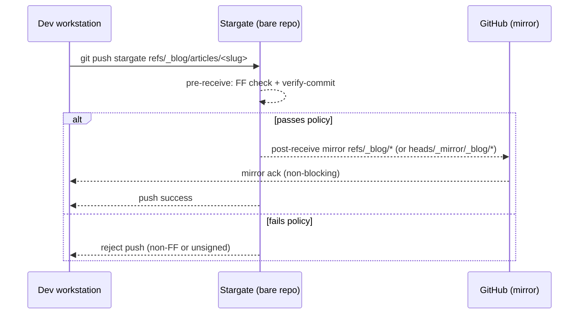
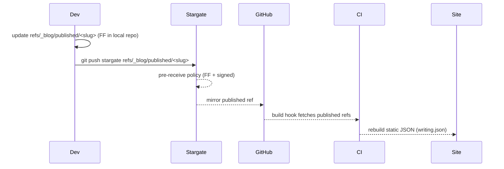

# Git-Stargate


Git-Stargate is a lightweight gateway for Git refs that *aren't* normal branches (e.g., `refs/_blog/*`, `refs/kv/*`, `refs/_shiplog/*`). It enforces fast-forward-only updates, requires signed commits, and can mirror accepted updates to your main remote (GitHub, GitLab, etc.). Perfect for ledger-style content, git-native CMS, and append-only logs.

### Features

- **FF-only**: Rejects non-fast-forward pushes on chosen namespaces.
- **Signed-only**: Every commit an update adds must carry a good signature, not just the new tip.
- **Who may write what**: A trust ref binds ref patterns to signing principals, so a valid key still cannot write someone else's lane.
- **No silent deletes**: Deleting a namespace ref is refused unless you allow it.
- **Mirroring**: Accepted refs are pushed upstream, optionally under `refs/heads/_mirror/...` so GitHub shows them. Mirror failures are reported and logged, never silent.
- **Tiny footprint**: Bash hooks; no daemon needed. Works with bare repos over SSH.

## Quick start

```bash
# Create the gateway (re-run any time to update hooks or settings)
./scripts/bootstrap.sh --namespace 'refs/_blog/*' --namespace 'refs/warp/*' \
  --trust-dir ./trust /srv/git/stargate.git

# Optionally mirror accepted refs upstream
git --git-dir=/srv/git/stargate.git remote add origin git@github.com:you/yourrepo.git
```

Settings are stored in the gateway's own Git config (`stargate.*`), because hooks do not inherit the shell that ran `bootstrap.sh`. The `NAMESPACE` and `MIRROR_TO_HEADS=1` environment variables are still accepted by `bootstrap.sh`.

| Option | Config key | Default |
| --- | --- | --- |
| `--namespace GLOB` (repeatable) | `stargate.namespace` | `refs/_blog/*` |
| `--trust-ref REF` | `stargate.trustRef` | `refs/stargate/trust` |
| `--trust-dir DIR` | — (initialises the trust ref once) | — |
| `--mirror-remote NAME` | `stargate.mirrorRemote` | `origin` |
| `--mirror-heads` | `stargate.mirrorHeads` | `false` |
| `--mirror-heads-prefix P` | `stargate.mirrorHeadsPrefix` | `refs/heads/_mirror/` |
| `--allow-delete` | `stargate.allowDelete` | `false` |
| `--no-require-signed` | `stargate.requireSigned` | `true` |

## Trust

The trust ref (`refs/stargate/trust`) is a commit whose tree holds three files:

- `allowed_signers`: SSH keys in [`ssh-keygen` allowed-signers format](https://man.openbsd.org/ssh-keygen#ALLOWED_SIGNERS), one principal per key.
- `bindings`: which principals may sign commits for which refs. The first matching line wins; a guarded ref with no matching line is rejected.
- `admins`: principals who may change the trust ref.

```text
# bindings: <ref pattern> <principals>
#   *            matches anything, including /
#   {principal}  matches one path segment; as a principal it means "that segment"
refs/warp/*/writers/{principal}   {principal}
refs/_blog/*                      alice,bob
refs/kv/*                         *
```

With that file, `refs/warp/g/writers/alice` accepts only commits signed by `alice`, `refs/_blog/*` accepts `alice` or `bob`, and `refs/kv/*` accepts anyone listed in `allowed_signers`.

Rules:

- The operator creates the trust ref once with `bootstrap.sh --trust-dir DIR`. A push can never create or delete it, so the first pusher cannot claim the gateway.
- Each later change must be a linear, fast-forward commit signed by an admin of the trust state it replaces. A change that would leave no admin with a key is refused.
- Pushes to other refs are checked against the trust state the gateway already has. A push that enrols a key and uses it at once must be split into two pushes.
- Without a trust ref, Stargate falls back to the server's own signing config (`gpg.ssh.allowedSignersFile` or GPG keyring) and accepts any signature it trusts, with a warning.

Admins publish a new trust state from a clone that has the gateway as a remote named `stargate`:

```bash
git config gpg.format ssh
git config user.signingkey ~/.ssh/id_ed25519
./scripts/trust-update.sh --show                     # current files
./scripts/trust-update.sh -m "enrol bob" ./trust     # signed update
```

Trust bindings currently assume SSH signatures (`gpg.format=ssh`), since principals come from `allowed_signers`.

## Hooks

- `pre-receive`: fast-forward only, deletion policy, signatures on every new commit, trust bindings, and trust-ref update rules.
- `post-receive`: mirrors accepted namespace and trust refs upstream. Failures are printed to the pusher and appended to `stargate/mirror-failures` in the gateway repository; re-push the listed refs to recover.

## Why not GitHub branch protection?
Branch protection only covers `refs/heads/*`. If your ledger lives under custom refs, Git-Stargate enforces policy before anything hits GitHub. When GitHub visibility is needed, mirror to `refs/heads/_mirror/...`. Treat the gateway as the source of truth: anyone with push access to GitHub can still rewrite the mirror there.

## Development

```bash
make test   # bats
make lint   # shellcheck
```

The tests run every push through real hooks with an isolated `HOME` and Git config, so local settings such as `commit.gpgsign` cannot affect results.

## Roadmap
- Small Go CLI for nicer UX.
- Retry command for recorded mirror failures.
- GPG principals for trust bindings.

## License
[MIT](./LICENSE)
_© James Ross • [flyingrobots](http://github.com/flyingrobots)_


## Sequence: push path with stargate



## Sequence: publish (fast-forward only)



## Why this exists
- Enforce FF-only and signed commits on non-branch namespaces (`refs/_blog/*`, `refs/kv/*`, etc.).
- Provide a tiny gateway that mirrors accepted refs to GitHub while rejecting bad pushes early.
- Keep custom ledgers (commit-message articles, KV, shiplog) safe from force pushes and unsigned writes.
```
